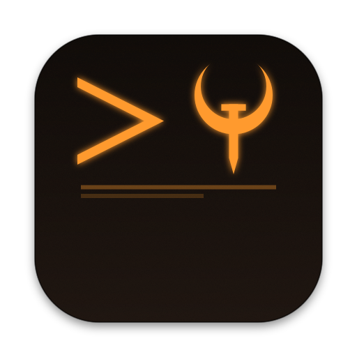

<p align="center">
  
</p>

<h1 align="center">Quaterm</h1>

<p align="center">
  <a href="https://github.com/ghostty-org/ghostty">libghostty</a> で動く、Quake 風のドロップダウン型ターミナル (macOS 用)<br>
  <a href="README.md">English</a>
</p>

---

ホットキーを押すと、画面の上端 (または下端) からターミナルが出てくる。もう一度押すと隠れる。

iTerm2 のホットキーウィンドウを、小さくて速いアプリで置き換えるために作った。端末の解釈と Metal による描画は libghostty が担当する。Quaterm が作っているのは、その周りのウィンドウ・タブ・環境設定だけである。

## 機能

- **グローバルホットキー**: どのアプリ・どのデスクトップ (Space) からでも、フルスクリーンのアプリの上でも呼び出せる (既定は <kbd>Control</kbd>+<kbd>`</kbd>)
- **上から / 下から**出す方向を選べる。アニメーションの速さとフェードの有無も変えられる
- **横幅はディスプレイいっぱい**。縦幅は画面の高さに対する割合 (20〜100%、既定 40%) で決める。伸ばす・縮めるキーで 5% ずつ変えられ、変えた高さは保存される
- **タブ**: <kbd>⌘</kbd><kbd>T</kbd> で開き、<kbd>⌘</kbd><kbd>W</kbd> で閉じる。マウスを乗せたタブに閉じるボタンが出る
- **ピン留め**: オンにすると、別のウィンドウをクリックしても最前面に残る。オフのときは、別の場所をクリックした時点で隠れる
- **コマンド終了の通知**: ターミナルが隠れている間に、N 秒 (既定 10 秒) 以上かかったコマンドが終わると、返り値と実行時間を通知する。「常に」と「失敗時のみ」から選べる
- **表示するディスプレイ**: メイン、アクティブ (マウスがある画面)、指定したディスプレイの 3 つから選ぶ。指定したディスプレイが外れていたら、代わりの表示先をたずねて覚える
- **フォント**の種類と大きさ、タブごとの拡大・縮小キー、不透明度をスライダーで決められる半透明の背景
- 選択するだけでコピー、スクロールバックの行数、Dock アイコンの表示・非表示、確認ダイアログ (どれも <kbd>Esc</kbd> でキャンセルできる)

画面分割、縁をドラッグしてのサイズ変更、テーマ、プロファイルは、意図して入れていない。

## 既定のキー

下のキーは、すべて環境設定で変えられる。

| 操作 | キー | 効く範囲 |
|---|---|---|
| 表示 / 非表示 | <kbd>Control</kbd>+<kbd>`</kbd> | どこでも |
| ピン留めの切り替え | <kbd>⌘</kbd><kbd>⇧</kbd><kbd>P</kbd> | ターミナルが前面にあるとき |
| 新しいタブ | <kbd>⌘</kbd><kbd>T</kbd> | ターミナルが前面にあるとき |
| タブを閉じる | <kbd>⌘</kbd><kbd>W</kbd> | ターミナルが前面にあるとき |
| 伸ばす / 縮める | <kbd>⌘</kbd><kbd>⌥</kbd><kbd>=</kbd> / <kbd>⌘</kbd><kbd>⌥</kbd><kbd>-</kbd> | ターミナルが前面にあるとき |
| 文字を大きく / 小さく | <kbd>⌘</kbd><kbd>⇧</kbd><kbd>;</kbd> (JIS 配列では <kbd>⌘</kbd><kbd>⇧</kbd><kbd>+</kbd>) / <kbd>⌘</kbd><kbd>⇧</kbd><kbd>-</kbd> | ターミナルが前面にあるとき |
| 半透明の切り替え | <kbd>⌘</kbd><kbd>U</kbd> | ターミナルが前面にあるとき |

<kbd>⌘</kbd><kbd>,</kbd> (環境設定) と <kbd>⌘</kbd><kbd>Q</kbd> (終了) は固定で、変えられない。

システム全体で監視するのは「表示 / 非表示」のキーだけである。そのため、<kbd>⌘</kbd><kbd>T</kbd> などはほかのアプリでもふつうに使える。

## 動作環境

- macOS 14 Sonoma 以降
- Swift 6.2 を含む Xcode (Xcode 26 以降)。開発は Xcode 27.0 で行った
- [XcodeGen](https://github.com/yonaskolb/XcodeGen)

## インストール

配布用のビルド済みアプリは無い。使う Mac ごとに、次のコマンドでビルドとインストールを行う。

```sh
brew install xcodegen
git clone https://github.com/salexkidd/Quaterm.git
cd Quaterm
./scripts/install.sh
open /Applications/Quaterm.app
```

`install.sh` は Release 構成でビルドし、`Quaterm.app` を `/Applications` にコピーする (`INSTALL_DIR` を指定すると、コピー先を変えられる)。`xcode-select` が Command Line Tools を指していても、`/Applications` にある Xcode を探して使う。更新するときは `git pull` してからもう一度実行し、Quaterm を再起動する。

アプリはアドホック署名 (開発者証明書を使わない簡易署名) で、Apple の公証は受けていない。自分でビルドしたアプリなら、それで問題なく起動する。macOS が公証を確認するのは、インターネットからダウンロードしたアプリだけだからである。初回起動時に通知の許可を求められる。アクセシビリティの権限は不要である。

### 補足

- `xcodebuild` が「active developer directory が Command Line Tools を指している」というエラーを出した場合は、Xcode を指すように切り替える。`sudo xcode-select -s /Applications/Xcode.app/Contents/Developer` を実行するか、コマンドの先頭に `DEVELOPER_DIR=/Applications/Xcode.app/Contents/Developer` を付ける
- コマンド終了の通知は、シェル統合 (OSC 133 という、コマンドの開始と終了をターミナルに伝える仕組み) を使う。libghostty が **zsh** と **bash** には自動で組み込む。それ以外のシェルには対応していない
- 表示 / 非表示のキーを押しても何も起きない場合は、ほかのアプリが同じキーを使っている可能性が高い。環境設定の「ショートカット」で別のキーにする

## 開発

```sh
# アプリのロジック (位置計算、ディスプレイの選択、通知、設定値) の単体テスト
cd Packages/QuatermCore && swift test

# Lint
xcrun swift-format lint -r App Packages/QuatermCore/Sources Packages/QuatermCore/Tests

# design/AppIcon.svg からアプリアイコンを作り直す (brew install librsvg が必要)
./scripts/make-icon.sh
```

仕様書は [docs/spec.md](docs/spec.md) にある。

> [!WARNING]
> libghostty の埋め込み API は、安定した公開 API ではない。Quaterm は [libghostty-spm](https://github.com/Lakr233/libghostty-spm) のバージョンを固定している。上げるときは、動作を確かめてから上げる。

## 使っているライブラリ

- [libghostty](https://github.com/ghostty-org/ghostty) ([libghostty-spm](https://github.com/Lakr233/libghostty-spm) 経由): 端末の解釈と描画
- [KeyboardShortcuts](https://github.com/sindresorhus/KeyboardShortcuts): グローバルホットキーと、キーを登録する画面部品

## ライセンス

[MIT](LICENSE)

Quaterm は、id Software および Ghostty プロジェクトとは関係がなく、承認も受けていない。「Quake」はその権利者の商標であり、ここではウィンドウの出方を説明するためだけに使っている。
