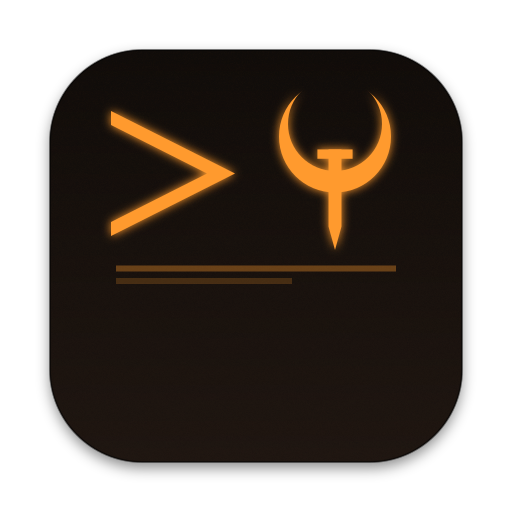

<p align="center">
  
</p>

<h1 align="center">Quaterm</h1>

<p align="center">
  A Quake-style drop-down terminal for macOS, powered by <a href="https://github.com/ghostty-org/ghostty">libghostty</a>.<br>
  <a href="README.ja.md">日本語</a>
</p>

---

Press a hotkey and a terminal slides down from the top (or up from the bottom) of your screen. Press it again and it goes away.

Quaterm aims to replace iTerm2's hotkey window with something small and fast. Terminal emulation and Metal rendering come from libghostty; Quaterm only adds the window, tabs, and preferences around it.

## Features

- **Global hotkey** to show / hide the terminal from any app, any Space, even over full-screen apps (default: <kbd>Control</kbd>+<kbd>`</kbd>)
- **Slide from the top or bottom**, with adjustable animation speed and optional fade
- **Full display width**; height is a percentage of the screen (20–100%, default 40%). Grow / shrink keys change it in 5% steps and the size is remembered
- **Tabs** at the top, the bottom, or the same side the window slides from, with <kbd>⌘</kbd><kbd>T</kbd> / <kbd>⌘</kbd><kbd>W</kbd>, <kbd>⌘</kbd><kbd>→</kbd> / <kbd>⌘</kbd><kbd>←</kbd> to switch, and a close button on hover
- **Pin**: keep the terminal on top even when you click another window. Unpinned, it hides as soon as you switch to another app (Quaterm's own Preferences window does not count)
- **Command-finished notifications**: when the terminal is hidden and a command that ran for at least N seconds (default 10) finishes, you get a notification with its exit code and duration. Choose "always" or "failures only"
- **Display choice**: main display, active display (where the mouse is), or a specific display. If that display is disconnected, Quaterm asks where to show instead and remembers the answer
- **Font** family and size, per-tab zoom keys, and a translucent background with an opacity slider
- Copy on select, configurable scrollback, optional Dock icon, confirmation dialogs (all cancellable with <kbd>Esc</kbd>)

Out of scope on purpose: split panes, resizing by dragging the edge, themes, and profiles.

## Default keys

Every key below can be changed in Preferences.

| Action | Key | Where it works |
|---|---|---|
| Show / hide | <kbd>Control</kbd>+<kbd>`</kbd> | Everywhere |
| Pin / unpin | <kbd>⌘</kbd><kbd>⇧</kbd><kbd>P</kbd> | When the terminal is in front |
| New tab | <kbd>⌘</kbd><kbd>T</kbd> | When the terminal is in front |
| Close tab | <kbd>⌘</kbd><kbd>W</kbd> | When the terminal is in front |
| Next / previous tab | <kbd>⌘</kbd><kbd>→</kbd> / <kbd>⌘</kbd><kbd>←</kbd> | When the terminal is in front |
| Taller / shorter | <kbd>⌘</kbd><kbd>⌥</kbd><kbd>=</kbd> / <kbd>⌘</kbd><kbd>⌥</kbd><kbd>-</kbd> | When the terminal is in front |
| Larger / smaller text | <kbd>⌘</kbd><kbd>⇧</kbd><kbd>;</kbd> / <kbd>⌘</kbd><kbd>⇧</kbd><kbd>-</kbd> | When the terminal is in front |
| Toggle translucency | <kbd>⌘</kbd><kbd>U</kbd> | When the terminal is in front |

<kbd>⌘</kbd><kbd>,</kbd> (Preferences) and <kbd>⌘</kbd><kbd>Q</kbd> (Quit) are fixed.

Only the show / hide key is registered system-wide, so <kbd>⌘</kbd><kbd>T</kbd> and friends keep working in your other apps.

## Requirements

- macOS 14 Sonoma or later
- Xcode with Swift 6.2 (Xcode 26 or later). Developed with Xcode 27.0
- [XcodeGen](https://github.com/yonaskolb/XcodeGen)

## Install

There is no prebuilt release. Build and install it on each Mac with one command:

```sh
brew install xcodegen
git clone https://github.com/salexkidd/Quaterm.git
cd Quaterm
./scripts/install.sh
open /Applications/Quaterm.app
```

`install.sh` builds the Release configuration and copies `Quaterm.app` to `/Applications` (set `INSTALL_DIR` to change it). It finds Xcode in `/Applications` even if `xcode-select` points at the Command Line Tools. To update, `git pull` and run it again, then restart Quaterm.

The app is ad-hoc signed and not notarized. That is fine for a copy you build yourself: macOS only checks notarization for apps downloaded from the internet. macOS asks for notification permission on first launch; Quaterm does not need Accessibility permission.

### Notes

- If `xcodebuild` says the active developer directory is a Command Line Tools instance, point it at Xcode: `sudo xcode-select -s /Applications/Xcode.app/Contents/Developer`, or prefix the command with `DEVELOPER_DIR=/Applications/Xcode.app/Contents/Developer`.
- Command-finished notifications rely on shell integration (OSC 133). libghostty injects it automatically for **zsh** and **bash**. Other shells are not supported.
- If the show / hide key does nothing, another app probably owns the same shortcut. Pick a different one in Preferences → Shortcuts.

## Development

```sh
# Unit tests for the app's logic (geometry, display choice, notifications, settings)
cd Packages/QuatermCore && swift test

# Lint
xcrun swift-format lint -r App Packages/QuatermCore/Sources Packages/QuatermCore/Tests

# Regenerate the app icon from design/AppIcon.svg (needs: brew install librsvg)
./scripts/make-icon.sh
```

The full specification (in Japanese) is in [docs/spec.md](docs/spec.md).

> [!WARNING]
> libghostty's embedding API is not a stable public API. Quaterm pins an exact version of [libghostty-spm](https://github.com/Lakr233/libghostty-spm); upgrade it deliberately and test before you do.

## Built with

- [libghostty](https://github.com/ghostty-org/ghostty) via [libghostty-spm](https://github.com/Lakr233/libghostty-spm) — terminal emulation and rendering
- [KeyboardShortcuts](https://github.com/sindresorhus/KeyboardShortcuts) — global hotkey and the shortcut recorder

## License

[MIT](LICENSE)

Quaterm is not affiliated with or endorsed by id Software or the Ghostty project. "Quake" is a trademark of its respective owner and is used here only to describe the style of the window.
